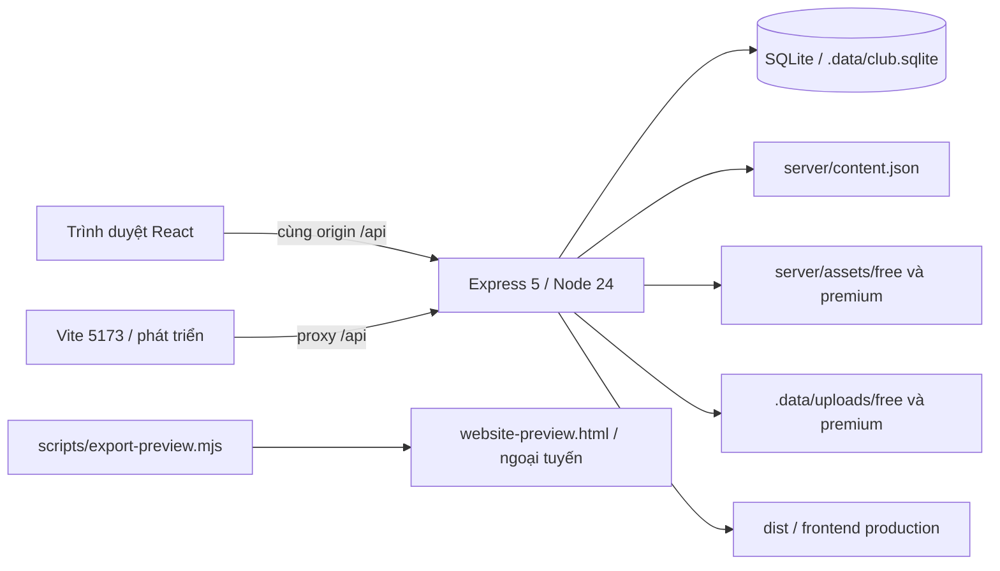

# Bàn giao kỹ thuật F5 AI Studio

Tài liệu này mô tả mã nguồn hiện có để agent tiếp theo tiếp tục chạy, kiểm tra và triển khai; không phải bản cam kết rằng website đã được xuất bản. Đường dẫn trong tài liệu tính từ thư mục gốc dự án. Thông tin được đối chiếu trực tiếp với source `server/`, `src/`, `scripts/`, các bài kiểm tra và `Dockerfile` ngày 10/10/2026. Đọc cùng `CLAUDE.md`, tài liệu vào việc trong gói handover và `README.md`.

## 1. Trạng thái thực tế và ranh giới bàn giao

- Có một ứng dụng đầy đủ gồm frontend, API, SQLite, đăng ký/đăng nhập, quản trị tài nguyên và mở quyền cao cấp sau xác nhận chuyển khoản thủ công.
- Có một bản `website-preview.html` mở trực tiếp bằng trình duyệt. Đây là giao diện ngoại tuyến có tài nguyên miễn phí, không phải bản server đã triển khai. Tài khoản, quản trị và thanh toán không hoạt động trong file này.
- Chưa có domain, hosting, địa chỉ website công khai hay tích hợp giao dịch ngân hàng thật được cung cấp trong phiên làm việc. `Publish` môi trường cloud chỉ lưu môi trường, không xuất bản website.
- Không có video giảng viên thật, ComfyUI runtime, checkpoint/model AI hay GPU trong source. Các video dài 1 giây dùng trong kiểm tra là fixture phần mềm; không phải nội dung giảng dạy.
- Nội dung miễn phí hướng dẫn quy trình tạo phim 3 phút; người học vẫn cần tự thực hành và cài công cụ phù hợp. Không có tính năng tự render phim bằng một nút hoặc bảo đảm doanh thu.
- Giá 199.000 VND/30 ngày là phương án đã chủ động đề xuất trong triển khai, nằm trong hằng số server. Đây chưa phải cấu hình thương mại do người dùng xác nhận bằng giao dịch thực.

## 2. Kiến trúc



| Thành phần | Hiện có | Ý nghĩa khi tiếp tục |
| --- | --- | --- |
| Frontend | React 19, TypeScript strict, Vite 6, `lucide-react` | Một SPA, không Next.js và không cần service frontend riêng ở production |
| Backend | Express 5, ESM JavaScript | API cùng origin với frontend; thư mục `server/` không được đưa vào static web root |
| Database | `node:sqlite` / `DatabaseSync` | Cần Node 24 trở lên; không cần PostgreSQL, MySQL hoặc native SQLite npm package |
| Auth | scrypt, cookie phiên HTTP-only | Quyền được kiểm tra trên server, không dựa vào localStorage |
| Upload | Multer disk storage | Tối đa 100 MiB/file; cần storage bền vững và writable |
| Frontend assets | Font Be Vietnam Pro và ảnh cục bộ | Không phụ thuộc CDN font/ảnh cho nội dung mặc định |
| Production | Express phục vụ `dist/` và API cổng 3001 | Cần HTTPS reverse proxy hoặc hosting hỗ trợ Node + persistent disk |
| Portable preview | Một HTML nhúng JS/CSS/font/ảnh/file miễn phí | Chỉ dùng duyệt giao diện và tài nguyên seed ngoại tuyến |

`server/index.mjs` export `createApp(options)` để test có thể truyền database, content, assets, uploads, môi trường và dist riêng. Khi được gọi trực tiếp, file mở listener `0.0.0.0:<PORT>` hoặc chạy bootstrap admin nếu có `--create-admin`. `SIGINT`/`SIGTERM` đóng HTTP server rồi database.

Các thao tác SQLite và đọc `content.json` hiện đồng bộ. Đây là cách đơn giản phù hợp một instance ban đầu; chưa có worker queue, cache tài nguyên, sharding, phân trang hay cơ chế scale nhiều instance dùng chung database qua mạng.

## 3. Bản đồ source

| File/thư mục | Trách nhiệm |
| --- | --- |
| `package.json`, `package-lock.json` | Scripts, engines Node, versions đã khóa bằng lockfile |
| `src/main.tsx` | Mount ứng dụng, import font/CSS |
| `src/App.tsx` | Navigation, thư viện, tìm kiếm/lọc/sort, roadmap, saved, modal, user state |
| `src/api.ts` | `fetch` same-origin, JSON, chuẩn hóa lỗi API |
| `src/types.ts` | Kiểu Resource, Download, User, Order, PaymentConfig cho frontend |
| `src/styles.css` | Layout trang, sidebar, card, breakpoint responsive |
| `src/dialogs.css` | Layout modal và quản trị responsive |
| `src/components/DialogShell.tsx` | Portal modal, focus trap, Escape, restore focus, khóa scroll |
| `ResourceDialog.tsx` | Đọc bài, video, file miễn phí/cao cấp, lưu và CTA tham gia |
| `AuthDialog.tsx` | Đăng ký/đăng nhập, gọi API thật |
| `MembershipDialog.tsx` | Quan tâm, tạo đơn, hướng dẫn chuyển khoản, refresh quyền |
| `AdminDialog.tsx` | Đơn, đối chiếu/duyệt, danh sách quan tâm, container CMS |
| `ContentManager.tsx` | Đăng/sửa/gỡ bài; upload và liên kết file/video theo tier |
| `server/index.mjs` | Middleware, quyền, toàn bộ route API, files/video/static, bootstrap admin |
| `server/db.mjs` | Schema, mở SQLite, hash/verify password, public user shape |
| `server/content.json` | 8 tài nguyên seed; nội dung nền khi database chưa có override |
| `server/assets/free/` | 14 file thực hành miễn phí độc nhất |
| `server/assets/premium/` | 3 file cao cấp độc nhất; không đặt trong `public/` |
| `public/images/`, `public/favicon.svg` | Cover cục bộ và favicon; credits ở `images/credits.json` |
| `scripts/dev.mjs` | Spawn API 3001 và Vite 5173, quản lý shutdown |
| `scripts/production-env.mjs` | Chuẩn hóa `NODE_ENV=production` cho `npm start` đa hệ điều hành; đọc source cuối trong gói |
| `scripts/export-preview.mjs` | Sinh một HTML ngoại tuyến từ build + tài nguyên seed |
| `tests/backend.test.mjs` | 8 bài kiểm tra API/dữ liệu/quyền với fixture tạm |
| `tests/browser-smoke.cjs` | Trình duyệt chạy đối với địa chỉ đang hoạt động; có tạo tài khoản test |
| `tests/admin-browser.cjs` | Server/database/upload tạm riêng cho toàn bộ luồng CMS + thành viên |
| `Dockerfile`, `.dockerignore` | Image production Node 24, user node, healthcheck |
| `.env.example` | Mẫu cấu hình không chứa secret |
| `.data/` | Database và uploads thật; bị Git ignore, không đưa vào gói mã nguồn |
| `.playwright/` | Ảnh/log/download thử; bị Git ignore, không phải public hosting |

## 4. Lệnh và cấu hình runtime

### Lệnh chính

```text
npm ci                 Cài đúng package-lock.json
npm run dev            API 3001 + Vite 5173
npm run dev:web        Chỉ Vite
npm run dev:api        Chỉ API, đọc .env nếu tồn tại
npm run build          TypeScript check + Vite build vào dist
npm start              Production server, đọc .env nếu tồn tại
npm run admin          Tạo/cập nhật admin từ env riêng
npm test               Các bài kiểm tra API cô lập
npm run test:browser   Test browser đối với website đang chạy
npm run test:admin     Test CMS/paid quyền với server/database tạm tự khởi động
npm run preview:export Build và tạo website-preview.html
```

`npm start` trong gói bàn giao dùng Node preload `scripts/production-env.mjs` để tránh cú pháp gán biến môi trường POSIX làm lỗi trên Windows. Nếu đọc một checkout cũ chưa có sửa này, dùng trực tiếp `node --env-file-if-exists=.env server/index.mjs` với `NODE_ENV=production` được đặt bằng cú pháp hệ điều hành. Luôn đối chiếu `package.json` thực tế.

`npm run dev` cố định API `PORT=3001`, Vite `5173` với `strictPort: true`. Không tự đổi sang cổng khác khi bận. Frontend có HMR; backend không có watch mode. Sau khi sửa `server/` hoặc `.env`, khởi động lại cả dev command. Trên Claude Code Desktop, giữ terminal dev hoạt động và mở trình duyệt trên máy chạy lệnh; link localhost chỉ có ý nghĩa trên chính máy đó.

### Environment variables

| Biến | Mặc định/điều kiện | Ghi chú |
| --- | --- | --- |
| `PORT` | `3001` cho server trực tiếp | Bị dev launcher ép 3001; production có thể đổi |
| `NODE_ENV` | Production do `npm start`/Docker đặt | `production` bật cookie Secure; phải truy cập bằng HTTPS để lưu cookie thật |
| `APP_ORIGIN` | Có mẫu development trong `.env.example` | Production đặt origin HTTPS chính xác, không kèm path; dùng kiểm tra request ghi |
| `TRUST_PROXY` | Chỉ chuỗi `1` bật Express trust proxy 1 hop | Chỉ dùng với một reverse proxy đáng tin; ảnh hưởng protocol và req.ip |
| `DATABASE_PATH` | `.data/club.sqlite` theo vị trí source | Có thể đặt đường dẫn tuyệt đối; uploads mặc định cạnh database trong `uploads/` |
| `BANK_NAME` | Trống | Cùng 2 biến bank còn lại quyết định bật tạo đơn |
| `BANK_ACCOUNT` | Trống | Đây là thông tin nhận tiền công khai, không phải API credential ngân hàng |
| `BANK_ACCOUNT_NAME` | Trống | Cả 3 trường trim phải có giá trị thì `paymentConfigured=true` |
| `F5AI_ADMIN_EMAIL` | Không mặc định | Chỉ dùng khi chủ động chạy `npm run admin` |
| `F5AI_ADMIN_PASSWORD` | Không mặc định, 12–128 ký tự | Bootstrap hash xong xóa khỏi env cục bộ; không đưa vào chat/Git/ZIP |
| `CHROMIUM_PATH` | `/usr/bin/chromium` trong browser scripts | Đường dẫn executable Chromium trên Desktop; Windows/macOS phải chỉnh hoặc dùng Playwright browser phù hợp |
| `BROWSER_BASE_URL` | Browser smoke dùng `http://127.0.0.1:5173` | Chỉ test smoke dùng biến này; admin test tự dựng server ở port tạm |

Các options `contentPath`, `assetsPath`, `uploadsPath`, `distPath` là tham số `createApp()` cho tests/custom integration, không phải env được server CLI tự đọc. Giá/thời hạn không có env hiện tại: sửa `PLAN_PRICE=199000`, `PLAN_DAYS=30` trong `server/index.mjs` nếu đổi phương án sản phẩm.

## 5. Schema SQLite và dữ liệu bền vững

`openDatabase()` tạo thư mục cha nếu cần, bật `PRAGMA foreign_keys=ON`, `journal_mode=WAL`, rồi `CREATE TABLE IF NOT EXISTS`. Chưa có migration version framework; thêm/sửa cột cần migration rõ ràng và backup trước khi chạy trên dữ liệu thật.

| Bảng | Cột chính | Ràng buộc/hành vi |
| --- | --- | --- |
| `users` | `id`, `name`, `email`, `password_hash`, `role`, `member_until`, `created_at` | UUID text PK; email unique case-insensitive; role user/admin; member_until ISO UTC hoặc null |
| `sessions` | `token_hash`, `user_id`, `expires_at` | SHA-256 token làm PK; FK user cascade delete; index expiry |
| `membership_orders` | `id`, `user_id`, `amount`, `currency`, `duration_days`, `reference`, `status`, `created_at`, `approved_at`, `approved_by` | reference unique; pending/approved; FK user cascade; approved_by FK admin; index user+date |
| `membership_interests` | `id`, `user_id`, `created_at` | Mỗi user tối đa 1 dòng; FK cascade; thao tác đăng ký idempotent |
| `resource_entries` | `id`, `payload`, `deleted`, `created_at`, `updated_at` | payload là JSON đầy đủ; deleted 0/1; ghi đè hoặc tombstone resource seed |
| `uploads` | `file`, `tier`, `name`, `mime`, `created_at`, `created_by` | tên file physical làm PK; free/premium; uploader FK user |

Dữ liệu thời gian dùng `new Date().toISOString()`. Cookie phiên hết sau 7 ngày. Mỗi request đọc quyền thành viên hiện tại từ `users`, vì vậy hết hạn được áp dụng ở server mà không cần cron. Admin luôn `isMember=true` dù `member_until` null.

Backup cần giữ **database + thư mục uploads cùng phiên bản**. Khi server đang chạy WAL, không chỉ copy `club.sqlite` bằng một lệnh file copy rồi xem đó là backup nhất quán. Phương án đơn giản lúc đầu: stop server, backup toàn bộ `.data/`, rồi start lại; hoặc dùng backup API/tool SQLite phù hợp. Restore thử ở thư mục/database riêng trước khi thay dữ liệu vận hành. Gói source không chứa `.data` và không phải backup tài khoản/đơn/upload production.

## 6. Hợp đồng JSON chung

Lỗi API là JSON `{ "error": "thông báo tiếng Việt" }`, đôi khi thêm `paymentConfigured:false`. `src/api.ts` ném lỗi từ `error` hoặc `message`; caller chịu trách nhiệm hiển thị lỗi.

Public user:

```json
{
  "id": "uuid",
  "name": "Tên người học",
  "email": "email@example.test",
  "role": "user",
  "isMember": false,
  "memberUntil": null
}
```

Password hash không trả về frontend. User role chỉ `user`/`admin`. `isMember` được tính từ role admin hoặc `member_until` tương lai, không có trường boolean persisted riêng.

Public resource trả các trường `id,title,description,type,category,image,duration,level,author,sections,freeDownloads,premiumDownloads,premiumBenefit,videoUrl,premiumVideoUrl,premiumVideoAvailable,featured,step,hasPremium,premiumAvailable,isLocked`. File descriptor public chỉ có `name,mime,url,locked`; **không có physical file path**. Guest/nonmember nhận premium descriptor với `url:null,locked:true`. Metadata/tên/lợi ích cao cấp vẫn công khai. Mọi `sections` là văn bản công khai, không có bài viết riêng bị khóa trong phiên bản này.

Order:

```json
{
  "id": "uuid",
  "amount": 199000,
  "currency": "VND",
  "durationDays": 30,
  "reference": "F5AI + 12 ký tự hex viết hoa",
  "status": "pending",
  "createdAt": "ISO UTC",
  "approvedAt": null
}
```

Admin list orders có thêm `user:{id,name,email}`. API phản hồi approval order đọc trực tiếp không join user nên user nằm ở trường response riêng.

## 7. API công khai và xác thực

| Method/route | Request | Thành công | Lỗi tiêu biểu |
| --- | --- | --- | --- |
| `GET /api/health` | Không body | 200 `{status:"ok"}` | Không kiểm tra toàn bộ dependency/cloud storage |
| `GET /api/session` | Cookie tùy chọn | 200 `{user:null hoặc PublicUser}` | Session hết hạn trả user null |
| `GET /api/resources` | Cookie tùy chọn | 200 `{resources:[PublicResource]}` | Lỗi parse seed/database → 500 |
| `GET /api/resources/:id` | Resource id | 200 `{resource:PublicResource}` | 404 không tồn tại/đã gỡ |
| `POST /api/auth/register` | JSON `{name,email,password}` | 201 `{user}` + cookie phiên | 400 invalid; 409 email đã đăng ký; 429 quá nhiều lần |
| `POST /api/auth/login` | JSON `{email,password}` | 200 `{user}` + thay phiên | 400 sai shape/length; 401 thông tin sai; 429 quá nhiều lần |
| `POST /api/auth/logout` | Không cần body | 200 `{user:null}` + clear cookie | Idempotent, không bắt buộc đang đăng nhập |

Đăng ký trim tên 1–100 ký tự, email trim/lowercase tối đa 254 ký tự theo regex cơ bản, mật khẩu 8–128 ký tự. Login không tiết lộ email có tồn tại qua thông báo lỗi; vẫn thực hiện scrypt fallback khi không tìm thấy account. Register hiện có 409 để người dùng biết email đã được đăng ký; chưa có email verification.

Middleware quyền:

- Không có user khi route yêu cầu login: 401.
- Đã login nhưng role không admin trên admin route: 403.
- Guest truy cập premium file/video: 401; user thường không còn quyền: 403.

## 8. API file và video

| Route | Miễn phí | Cao cấp | Kết quả |
| --- | --- | --- | --- |
| `GET /api/downloads/:resourceId/:tier/:index` | Không cần login | Cần member còn hạn hoặc admin | 200 attachment; 404 invalid tier/index/resource/file; 401/403 quyền; 500 nếu gửi file thất bại trước headers |
| `GET /api/videos/:resourceId/:tier` | Không cần login | Cần member còn hạn hoặc admin | 200 stream hoặc 206 Range qua Express sendFile; 404 chưa có video/tier; 401/403 quyền |

`tier` chỉ `free` hoặc `premium`; download `index` là số nguyên không âm viết bằng chữ số, trỏ vào mảng download của resource. Không nhận filepath trực tiếp từ URL. Download tên file dùng basename physical file, vì vậy upload có thể tải về tên `upload-<uuid>.<ext>` dù nhãn trên UI là tên dễ đọc. Đây là chỗ có thể cải thiện filename sau bàn giao.

Resolver chỉ nhận basename theo regex `[A-Za-z0-9][A-Za-z0-9._-]{0,180}`, không có slash. Nếu có bản ghi uploads đúng tier, lấy file từ uploads/tier; nếu không, lấy từ server/assets/tier. Kiểm tra tồn tại, regular file, không symlink và realpath nằm trong root tier. Không có static mount đối với `server/assets/premium/` hay `.data/uploads/`.

Video miễn phí ưu tiên `freeVideoFile`; nếu thiếu thì có thể dùng `videoUrl` URL http(s) trực tiếp do admin nhập. `<video>` HTML nhận MP4/WebM trực tiếp, không embed trang YouTube/Vimeo. Video cao cấp chỉ dùng file local `premiumVideoFile` và API kiểm tra quyền. Không có DRM, HLS transcoding, adaptive bitrate hay service object storage trong hiện trạng. Một phiên video đã bắt đầu không tự thu hồi byte đã tải; mỗi request mới được kiểm tra quyền.

## 9. API câu lạc bộ, đơn và xác nhận

| Method/route | Quyền | Thành công | Lỗi tiêu biểu |
| --- | --- | --- | --- |
| `GET /api/membership/config` | Công khai | 200 `{price,currency,durationDays,paymentConfigured,bank,interested}` | bank null khi chưa đủ 3 biến |
| `POST /api/membership/interest` | Login | 200 `{registered:true,interested:true,createdAt}` | 401 chưa login |
| `GET /api/membership/orders` | Login | 200 `{orders:[đơn của chính user]}` mới nhất trước | 401 chưa login |
| `POST /api/membership/orders` | Login | 201 `{order,payment}` cho đơn mới; 200 nếu trả đơn pending cũ | 401; 503 chưa cấu hình bank |
| `GET /api/admin/orders` | Admin | 200 `{orders:[tất cả đơn, có user]}` | 401/403 |
| `POST /api/admin/orders/:id/approve` | Admin | 200 `{order,user,alreadyApproved}` | 401/403; 404 không có đơn |
| `GET /api/admin/interests` | Admin | 200 `{interests:[{id,user:{id,name,email},createdAt}]}` | 401/403 |

Config `bank` nếu đủ dữ liệu là `{name,account,accountName}`. Interest lưu một dòng trong database, không gửi email hoặc thông báo ra ngoài. UI nói chủ club có thể liên hệ dựa trên danh sách; chưa có tích hợp gửi email trong code.

Luồng thanh toán thật cần con người:

1. Người dùng đăng nhập, tạo đơn.
2. Backend lưu số tiền/thời hạn vào đơn lúc tạo; reference `F5AI` + 6 random bytes chuyển hex uppercase.
3. Người dùng tự chuyển khoản theo tài khoản công khai và reference.
4. Admin xem tiền thực nhận ở ngân hàng, đối chiếu số tiền/reference/người gửi.
5. Admin chủ động xác nhận trong giao diện; server cập nhật member_until trong transaction.
6. Người dùng bấm kiểm tra trạng thái; UI gọi session để lấy quyền mới.

Chỉ tạo đơn hoặc bấm refresh không cấp quyền. Không có webhook, auto-check ngân hàng, QR VietQR generation, subscription provider, tự trừ tiền, hóa đơn VAT, cancellation/refund/rejected order status. Đơn chỉ pending hoặc approved.

Approval dùng `BEGIN IMMEDIATE`; nếu đơn chưa approved, tính `start=max(now, user.member_until hợp lệ)` rồi cộng `duration_days * 24h`. Ghi `approved_at`, `approved_by`, commit. Duyệt lại cùng đơn không cộng thêm ngày, `alreadyApproved=true`. Giá/thời hạn của đơn cũ không đổi khi sau này đổi hằng số plan. API hiện không cấm user còn hạn tạo đơn mới; **UI lại hiển thị active state mà chưa có nút gia hạn trước hạn**.

Việc trả lại đơn pending là kiểm tra SELECT rồi INSERT, không có unique partial index đảm bảo một pending/user ở mức database. Trong một process synchronous hiện tại thao tác này liền nhau; nếu sau này chạy nhiều processes/instances cần transaction hoặc ràng buộc database tương ứng.

## 10. API quản trị tài nguyên và upload

| Method/route | Request | Thành công | Lỗi tiêu biểu |
| --- | --- | --- | --- |
| `GET /api/admin/resources` | Admin cookie | 200 `{resources:[raw resource]}` bao gồm tên file physical | 401/403 |
| `POST /api/admin/resources` | JSON `{resource:{...}}` | 201 `{resource}` | 400 validation; 409 id đã tồn tại |
| `PUT /api/admin/resources/:id` | JSON `{resource:{...}}` | 200 `{resource}` | 400 validation/đổi id; 404 |
| `DELETE /api/admin/resources/:id` | Không body cần thiết | 200 `{deleted:true}` | 404; không xóa byte upload |
| `POST /api/admin/uploads?tier=free` | Multipart field `file` | 201 `{file,name,mime,tier}` | 400 tier/format/empty/multipart; 413 >100 MiB |
| `POST /api/admin/uploads?tier=premium` | Như trên | Như trên | Như trên |

Tất cả route trong bảng yêu cầu login + admin. Upload không dùng `src/api.ts` vì multipart cần trình duyệt tự đặt boundary; `ContentManager` gọi fetch với FormData, credentials same-origin, không tự set Content-Type.

Upload physical filename `upload-<randomUUID>.<lowercase extension>`, không dùng user filename làm đường dẫn. Cho phép `.html,.md,.csv,.srt,.json,.pdf,.zip,.txt,.mp4,.webm,.py`; mime lấy từ extension mapping. Bộ lọc hiện kiểm tra extension, chưa sniff magic bytes hoặc scan nội dung. Tối đa 1 file/request, 0 multipart text fields, 100*1024*1024 byte/file. UI cho chọn nhiều tài liệu nhưng upload tuần tự từng request. Empty file bị gỡ và trả 400; insert uploads thất bại thì file vừa ghi bị unlink.

Upload và publish resource là hai thao tác: upload thành công chưa làm file xuất hiện trong thư viện; phải save draft resource liên kết file. Hủy draft, gỡ attachment hoặc xóa bài chỉ bỏ liên kết, chưa có endpoint garbage collect/delete uploads. Khi upload nhiều file và một file sau thất bại, các file đã ghi trước vẫn có thể tồn tại không được dùng. Agent triển khai cần tính storage và có kế hoạch dọn mồ côi sau khi xác định không còn resource tham chiếu.

### Validation tài nguyên

| Trường | Quy tắc server |
| --- | --- |
| `id` | 1–80 ký tự `[A-Za-z0-9_-]`; create có thể tự sinh slug + random suffix; update không đổi id |
| `title` | Trim tối thiểu 3, tối đa 200 ký tự |
| `description` | String tối đa 1000 |
| `type` | `guide`, `video`, `workflow` |
| `category` | `Kịch bản`, `Nhân vật`, `Bối cảnh`, `Video`, `Hậu kỳ` |
| `image` | Tối đa 2000; `/images/...` đã normalize hoặc URL http(s), không credentials trong URL |
| `duration`, `level`, `author` | String tối đa 100; default `10 phút`, `Cơ bản`, `F5 AI` |
| `sections` | Tối đa 50 phần; title string <=200, body string <=20000; không parse HTML |
| `freeDownloads`, `premiumDownloads` | Tối đa 30/tier; name 1–200; physical file phải tồn tại đúng tier |
| `premiumBenefit` | String tối đa 1000 |
| `freeVideoFile`, `premiumVideoFile` | Nếu có, file MP4/WebM tồn tại đúng tier |
| `videoUrl` | null hoặc http(s)/route `/api/videos/<id>/free|premium`, tối đa 2000 |
| `featured` | Ép Boolean |
| `step` | Integer 1–99 |

UI ảnh bìa hiện chọn một trong 5 cover cục bộ; API nhận URL ảnh hợp lệ nhưng chưa có upload ảnh bìa trong CMS. UI yêu cầu nội dung phần theo form; server cho mảng sections rỗng và không bắt min-length title/body mỗi section. Đừng giả định có rich text editor: body được React render dạng text giữ xuống dòng, không `dangerouslySetInnerHTML`.

## 11. Seed, override và xóa bài

Mỗi lần `resources()` được gọi:

1. Đọc/parse `server/content.json` (array trực tiếp hoặc object chứa `resources`).
2. Tạo Map theo id từ seed.
3. Duyệt `resource_entries`: deleted=1 thì xóa id khỏi Map; còn lại JSON payload ghi đè/thêm.
4. Trả danh sách hợp nhất; server không có pagination/search filters.

Admin save dùng UPSERT vào `resource_entries`, không sửa `content.json`. Xóa bài seed tạo tombstone nên bài không tự xuất hiện lại sau restart. Xóa bài mới cũng lưu tombstone. Không có UI restore/history/version undo; database giữ payload trước gỡ, nhưng phục hồi là thao tác kỹ thuật phải thực hiện có kiểm tra. Nếu chỉnh seed sau khi có override cùng id, override vẫn thắng; đây là hành vi cần hiểu khi cập nhật nội dung qua Git.

### Bộ nội dung hiện có

| Id | Bài | Loại / chặng |
| --- | --- | --- |
| `roadmap` | Lộ trình: phim AI 3 phút | guide / Kịch bản / step 1 |
| `script` | Viết kịch bản có thể sản xuất | guide / Kịch bản / step 2 |
| `storyboard` | Chia 30 shot cho phim 180 giây | guide / Kịch bản / step 3 |
| `character` | Tạo nhân vật dễ giữ nhất quán | guide / Nhân vật / step 4 |
| `environment` | Tạo bối cảnh dùng lại qua nhiều shot | guide / Bối cảnh / step 5 |
| `comfyui` | ComfyUI: tạo keyframe đầu tiên | workflow / Video / step 6 |
| `video` | Từ keyframe đến một clip ngắn | video / Video / step 7 |
| `edit` | Dựng, âm thanh và xuất tập phim | guide / Hậu kỳ / step 8 |

File miễn phí: `roadmap.html`, `script.html`, `storyboard.html`, `character.html`, `environment.html`, `comfyui.html`, `video.html`, `edit.html`, `script-prompts.md`, `character-prompts.md`, `environment-prompts.md`, `shotlist-3-minutes.csv`, `sample-subtitles.srt`, `comfyui-basic-sd15.json`.

File cao cấp: `plan-film.py`, `advanced-prompt-pack.md`, `production-checklist.html`. Các bài tái sử dụng một số file nên số download descriptors lớn hơn số file độc nhất. Workflow SD1.5 là core workflow tạo ảnh; không phải workflow video hoàn chỉnh đã render. Tài liệu video chỉ dẫn công cụ/model/phần cứng và lối animatic khi không có GPU. Nếu nâng cấp sang workflow video cụ thể, cần chạy thật, ghi version model/node, VRAM, thời gian/chi phí và xuất clip minh chứng.

## 12. Frontend và hành vi UX

- Bốn page state nội bộ: discover, roadmap, saved, help. Không có React Router/path routing riêng cho từng mục.
- Mở tài nguyên đặt `?resource=<id>` bằng History API; initial load/back/forward đọc query. Đóng resource dùng replaceState bỏ query.
- Saved lưu ids tại localStorage key `f5ai-saved`; không sync tài khoản hay máy khác. Bài đã gỡ có thể còn id trong saved nhưng không xuất hiện trong danh sách hợp nhất.
- Tìm kiếm trên title/description/category ở client; bỏ dấu kết hợp NFD và chuyển `đ` sang `d`, lowercase. Không tìm toàn bộ article body.
- Filter category + type + saved kết hợp. `recommended` ưu tiên featured rồi step tăng; `title` dùng locale vi; `newest` hiện thực tế **step giảm dần**, không có `publishedAt`.
- Roadmap bốn chặng nhóm tài nguyên theo category, không có quiz, completion tracking hoặc tiến độ cá nhân.
- Desktop sidebar cố định; tablet/mobile thay layout/menu/bottom navigation theo CSS. Các modal có focus trap, Escape, click backdrop, restore focus và giữ scroll trong viewport.
- Login từ câu lạc bộ quay lại membership sau đăng nhập. API kiểm tra premium độc lập với trạng thái frontend; refresh membership lấy `/api/session` để cập nhật member.
- Bộ article/video chưa có instructor media hiển thị thông báo đang chuẩn bị, không đưa video mẫu kiểm thử vào seed.
- Có retry/error/empty/loading state. Chưa có offline service worker/PWA; chỉ `website-preview.html` là ngoại tuyến riêng.

`Resource` TypeScript chung chưa mô tả toàn bộ trường server; component detail mở rộng kiểu cho premium video. Nếu thêm contract lớn, nên cập nhật type và cả public/admin serialization thay vì dựa trên cast hoặc thêm field tùy tiện.

## 13. Auth, middleware và giới hạn bảo mật đã biết

Đã triển khai:

- Salt ngẫu nhiên 16 byte, `scryptSync` 64-byte key; stored format `scrypt:<salt>:<hex>`, compare constant-time qua `timingSafeEqual`.
- Session token ngẫu nhiên 32 byte base64url; database chỉ lưu SHA-256 token, không plaintext cookie.
- Cookie `f5ai_session`: HTTP-only, SameSite=Lax, path `/`, TTL 7 ngày, Secure khi NODE_ENV production.
- Login xóa session token hiện tại rồi tạo token mới. Logout xóa token hiện tại. Session expired được bỏ qua; cleanup expired rows lúc tạo session mới.
- Giới hạn trong process (Map, tối đa 5000 khóa, cửa sổ 15 phút): đăng ký 30 lần/IP (đếm mọi lần); đăng nhập chỉ đếm **lần sai**: 50 lần sai/IP và 10 lần sai/email. Khi bị khóa, mật khẩu sai nhận 429 nhưng mật khẩu đúng vẫn đăng nhập được (kẻ đoán mật khẩu không khóa được chủ tài khoản; văn phòng chung IP không bị khóa vì đăng nhập nhiều). Không chia sẻ limit giữa instances và reset khi restart; sau reverse proxy phải bật `TRUST_PROXY` để mỗi người một IP (server cảnh báo khi `APP_ORIGIN` https mà chưa bật).
- Request ghi (không phải GET/HEAD/OPTIONS) bị từ chối 403 khi `Sec-Fetch-Site: cross-site` hoặc khi có Origin không thuộc: protocol/host hiện tại, HTTPS cùng host, `APP_ORIGIN` (ở production chỉ nhận `APP_ORIGIN` bắt đầu bằng `https://`, giá trị http còn sót từ `.env.example` bị bỏ qua kèm cảnh báo); hai origin dev 5173 chỉ được phép khi `NODE_ENV` khác `production`. Request không có Origin và không có Sec-Fetch-Site (client không phải trình duyệt) không bị chặn; cookie SameSite=Lax là lớp bảo vệ CSRF thứ hai; không có CSRF token riêng.
- Header mọi response: `Content-Security-Policy` (`default-src 'self'`, `script-src 'self'`, `style-src 'self' 'unsafe-inline'`, `img-src 'self' data: https:`, `media-src 'self' https: blob:`, `frame-ancestors 'none'`, `object-src 'none'`, `base-uri 'self'`, `form-action 'self'`), `X-Frame-Options: DENY`, `Cross-Origin-Resource-Policy: same-origin` (chặn hot-link video/file từ site khác), `Permissions-Policy` tắt camera/mic/geolocation/payment, `X-Content-Type-Options: nosniff`, `Referrer-Policy strict-origin-when-cross-origin`; `Strict-Transport-Security` 180 ngày khi production và (request đến qua TLS hoặc `APP_ORIGIN` là https). API `Cache-Control: no-store` kể cả download; video premium `private, no-store`. Bỏ X-Powered-By.
- Cookie Secure khi `NODE_ENV=production`; `COOKIE_SECURE=0|false|no|off` tắt cờ này cho demo HTTP nội bộ (script demo tự đặt), `1|true|yes|on` ép bật; giá trị khác làm server dừng ngay khi khởi động. `TRUST_PROXY` nhận cùng cú pháp.
- Ảnh bìa và video ngoài phải là `https://` (hoặc `/images/`, video đã upload) vì CSP chỉ cho `https:`; thông tin bank chỉ trả về cho người đã đăng nhập; mỗi người chỉ có một đơn chờ (unique index có điều kiện, hai cú bấm cùng lúc trả cùng một đơn); `npm run admin` đặt lại mật khẩu thì xóa mọi phiên cũ của tài khoản đó; danh sách `/api/resources` là bản tóm tắt không kèm `sections`, bài mở qua `/api/resources/:id`; catalogue seed + override được cache trong bộ nhớ và làm mới khi admin ghi hoặc seed đổi.
- Mật khẩu: scrypt 64 byte, salt 16 byte, so sánh constant-time; request handler dùng bản bất đồng bộ nên không chặn event loop khi nhiều người đăng nhập cùng lúc stream video/upload. Đăng ký trùng email khi chạy đua trả 409 thay vì 500.
- Upload admin: kiểm tra đuôi file **và** chữ ký nội dung 4 KB đầu (MP4 `ftyp`, WebM EBML, PDF `%PDF-`, ZIP `PK`, các định dạng text không chứa byte NUL); file sai bị xóa ngay khỏi đĩa và trả 400. Chưa quét mã độc.
- Parameterized SQLite queries, kiểm tra role và tier server, không static expose tài nguyên cao cấp, chống traversal/symlink ở resolver. Lỗi 4xx chỉ lộ thông điệp khi code đánh dấu `expose`; lỗi 5xx log method/path/mã lỗi server-side, client nhận thông điệp chung.
- Static: `/assets/*` (tên có hash) `Cache-Control: public, max-age=31536000, immutable`; `index.html` và SPA fallback luôn revalidate; đường dẫn có đuôi file không tồn tại trả 404 thay vì trả HTML.
- `/api/health` trả `{status, checks:{database, uploads}}`, 503 khi database hoặc thư mục upload không ghi được.
- Bootstrap admin không tự chạy khi server start và không có default email/password. Nếu email đã có, bootstrap chuyển role thành admin **và đặt lại password** bằng password được truyền.
- Giá/thời hạn gói đọc từ `PLAN_PRICE`/`PLAN_DAYS` (mặc định 199000/30); frontend hiển thị từ `/api/membership/config`.

Chưa triển khai: email verification, password reset/self-service change password, 2FA, mọi-phiên logout, session management UI, persistent shared rate limit (nhiều instance), quét mã độc file, audit log riêng cho mọi thay đổi CMS, quota storage/account, account deletion/export. Trạng thái approval có `approved_by/approved_at`, nhưng đó không thay thế audit log đầy đủ.

Khi triển khai, giữ một origin HTTPS, chỉ bật trust proxy đúng topology; reverse proxy có thể đặt thêm HSTS preload nếu muốn. Không gắn `.env`, `.env.demo`, source ZIP, `.data`, `.data-demo`, premium assets hoặc backups vào static root/CDN công khai. Member có thể giữ file đã tải sau hết hạn; đây là download membership, không phải DRM.

## 14. Production serving, Docker và hosting

Nếu có `dist/index.html`, API server mount `express.static(distPath)`, rồi SPA fallback cho các GET ngoài `/api`. API unknown route luôn JSON 404 trước static fallback. Không build trước khi start thì server chỉ có API và không có giao diện production. Static fallback cũng có thể trả HTML cho path asset không tồn tại; kiểm tra Content-Type/404 nếu cải thiện xử lý asset sau này.

Dockerfile:

- Multi-stage base `node:24-bookworm-slim`.
- Build chạy npm ci, Vite build, prune dev dependencies.
- Runtime chỉ copy package.json, node_modules production, server và dist; tạo `/app/.data` owned bởi `node`, `USER node`, cổng 3001.
- Healthcheck GET health bằng fetch Node mỗi 30 giây.
- Runtime container cần volume ở `/app/.data` hoặc DATABASE_PATH cùng uploads durable. Không mount secret ở build image; dùng runtime env/secret store.

Dockerfile đã được chuẩn bị nhưng **chưa được build/run xác nhận trong cloud ban đầu**. Agent tiếp theo cần thực hiện smoke image sau build; không ghi Docker đã kiểm chứng nếu chỉ đọc file. Source/natively running app đã được kiểm tra riêng.

Yêu cầu nơi triển khai: Node 24 support, một process dài hạn hoặc Docker, writable persistent storage, HTTPS, cấu hình env và restart/deploy có giữ dữ liệu. Chỉ host `dist/` trên một static site provider sẽ không có account/API/premium gate. Stateless/serverless platform với filesystem ephemeral không phù hợp cấu hình SQLite/upload hiện tại nếu chưa đổi kiến trúc. Muốn nhiều replicas cần DB/storage external và session/rate-limit cùng chia sẻ; chưa có trong source.

Không cần host GPU để chạy website; GPU chỉ phục vụ người học thực hành ComfyUI hoặc một tính năng render riêng trong tương lai. Không ghép GPU/job service vào phạm vi handover hiện tại mà không có yêu cầu sản phẩm rõ ràng.

## 15. HTML xem trước ngoại tuyến

`npm run preview:export` build rồi chạy exporter. Exporter đọc **seed** `server/content.json` và `server/assets/free/`, không đọc SQLite override/uploads. Bài do admin đăng sau này không tự vào preview. Cần mở rộng exporter có chủ đích nếu muốn xuất nội dung runtime.

File HTML chứa JS production, CSS, data URL fonts/covers, Blob cho 14 file miễn phí deduplicate; premium chỉ metadata khóa, không nhúng byte premium. Script bootstrap thay fetch bằng API giả lập read-only ở trình duyệt: resources/list/detail, session user null, payment chưa cấu hình; các request ghi trả 503 với lời giải thích cần website đầy đủ. Banner ngoại tuyến luôn hiển thị. Đây là simulation có ghi rõ cho preview, không phải giả lập thanh toán hoặc tài khoản thành công.

Không dùng HTML này để nhận email/mật khẩu/thanh toán. Handoff cho người xem: download về máy rồi mở bằng browser; file viewer trong chat/cloud có thể không chạy HTML. Không đổi tên nó thành bản triển khai production hoặc xem file link như public URL.

## 16. Bằng chứng kiểm tra và cách đọc kết quả

Trong cloud ban đầu đã có Node 24.19, Chromium, ffmpeg. Đã hoàn tất install, TypeScript/build, 8 API tests, responsive/functionality browser smoke, và bài test admin/payment quyền cô lập. Tài liệu verification trong gói ghi kết quả lần cuối khi đóng gói; đó là nguồn cập nhật nếu có sửa sau tài liệu này.

| Bài kiểm tra | Thực sự kiểm tra | Phạm vi/giới hạn |
| --- | --- | --- |
| `npm test` | Hash/session/auth; free/premium gate; interest idempotency; manual approval/idempotency/expiry; Origin/rate-limit; admin bootstrap; CMS persistence/tombstone; upload/video Range | 8 integration tests, database/fixture riêng; không giao dịch ngân hàng hoặc security penetration test |
| `npm run build` | TypeScript strict và frontend production build | Không chứng minh API đang hoạt động/hosting đã bật |
| `test:browser` | 1440, 820, 390, 360px; overflow/image loading; search/filter/roadmap/saved; thực download; register/login/logout/interest; 401/403 premium; runtime errors | Cần website đang chạy, **tạo synthetic account thật ở DB của địa chỉ test**; không chạy tùy tiện trên production |
| `test:admin` | Server tạm + DB/upload riêng; tạo2sections; uploadfree/premium HTML + video1sec; play/download; tạođơnfixture; explicit approval; quyềnpremium; edit/gỡ/tombstone; adminmobile | Cần build; Chromium; ffmpeg để kiểm tra video thật; nếu ffmpeg thiếu script skip video fixture và log SKIP |
| Preview manual browser test | file:// desktop/mobile, assets, tìmkiếm, downloadfree, khôngnetwork/error, khôngwrite giả thành công | Đã kiểm tra file xuất lúc đó; exporter assumptions cần test lại nếu Vite tạo nhiều bundle/chunk |

Không dùng tài khoản test admin/bank fixture cho website thật. Không suy luận từ test payment rằng ngân hàng đã tích hợp. Khi chạy `test:browser`, dùng database dev riêng; nếu cần dọn synthetic account, xác định chính xác email vừa tạo, không xóa hàng loạt user theo phỏng đoán.

## 17. Backlog kỹ thuật đã xác định

Các mục dưới đây là **chưa làm**, không phải chức năng hiện có. Ưu tiên đầu tiên vẫn là chạy được trên máy Desktop và đưa bản đầy đủ lên một địa chỉ HTTPS có dữ liệu bền vững; tránh viết lại toàn bộ app trước khi có bàn giao truy cập thực.

| Ưu tiên | Việc tiếp theo | Tiêu chí hoàn thành có thể kiểm tra |
| --- | --- | --- |
| P0 | Triển khai Node/Docker + HTTPS + volume + origin | Public URL mở được từ máy khác, register/login giữ cookie, restart giữ user/upload, guest không tải premium |
| P0 | Bootstrap admin và cấu hình bank thật bằng secret cục bộ | Không có default credential; chủ vận hành login được; bank công khai đúng; chỉ duyệt sau đối chiếu tiền thật |
| P0 | Backup/restore và restart runbook | Restore database + uploads trên instance tạm và kiểm tra resource/user/download hoạt động |
| P1 | Bổ sung video/lesson/workflow cao cấp thật | Free excerpt và fullvideo riêng; member play; ghi rõ model/node/version/hardware thực chạy |
| P1 | Gia hạn còn hạn trong UI | User active tạo yêu cầu mới; approval cộng từ member_until; approve lại không cộng lần hai |
| P1 | Sửa sort mới nhất | Có publishedAt/createdAt trong contract/seed/overrides, sort theo timestamp thực; migration không làm đổi bài cũ |
| P1 | Tên download dễ đọc | Content-Disposition lấy tên gốc an toàn/phù hợp extension, không đổi resolver hay lộ path |
| P1 | Quản lý upload mồ côi/quota | Inventory tham chiếu trước khi xóa; không xóa file dùng ở nhiều bài; có confirm cụ thể và backup |
| P1 | Hardening account/origin/upload | Origin allow-list theo môi trường; reset-password/mail nếu có provider; nội dungfile validation; proxy headers/trust test |
| P2 | Draft/revision/restore CMS và audit log | Không publish dở dang; biết ai đổi gì khi nào; restore seed/override không mất upload |
| P2 | SEO bài, analytics/conversion hợp lý | URL bài crawlable/meta phù hợp nếu chọn SSR/prerender; đo đọcfree→club mà không thay UX đơn giản |
| P2 | Cloud/object storage và scale khi có tải thật | Signed premium URLs/check member, schema/session/rate-limit shared; migration từ SQLite có rollback |

Đừng đổi account/admin/payment sang localStorage hoặc mock để có demo trông như chạy đủ. Nếu agent chọn hosting nhưng thiếu quyền tài khoản/domain, hoàn tất build, cấu hình, healthcheck và hướng dẫn cụ thể; ghi blocker chính xác, không bịa public URL hoặc hứa đã triển khai.

## 18. Nguyên tắc agent kế tiếp cần giữ

1. Đọc source và kiểm tra trạng thái trước khi sửa; không giả định server, Git remote hoặc filesystem của cloud còn tồn tại trên Desktop.
2. Giữ free workflow đủ quy trình tạo phim đầu tiên; premium bán giá trị tốc độ/chất lượng/chi phí/dễ vận hành, không biến free thành bài cụt không dùng được.
3. Chọn thay đổi nhỏ, có thể review; không đổi stack chỉ vì sở thích. Không cần tạo GPU backend để host thư viện.
4. Bảo vệ dữ liệu runtime, `.env`, private premium assets và credentials trong mọi archive/static deploy/log.
5. Chạy test phù hợp sau thay đổi, báo đúng môi trường và giới hạn. Test qua browser fixture khác test ngân hàng/GPU thật.
6. Bàn giao **cách người dùng mở website thực**: URL HTTPS sau deploy hoặc local Desktop browser cho bản chạy máy cá nhân, cộng admin/runbook. Screenshot hay `Publish` environment không thay việc này.

